<picture>
  <source media="(prefers-color-scheme: dark)" srcset="docs/assets/s1ght-banner-dark.svg">
  
</picture>

# S1GHT — Real-Time Visual Decisions

S1GHT asks decision models typed questions about images and video: *is this person wearing a hard hat?*, *which of these four is the scene?*, *how crowded is it, from 0 to 3?* Answers are calibrated probabilities, not generated text. On video, a detector tracks objects and S1GHT asks about each track in the background, so the detector never waits for the decision model.

- **One question format.** Questions and answers follow the TypeSafe `/v1/systemone` schema (`noul`, `choice`, `score`, `box`). The same request runs on a local model, on Ollama/Ollaya, on vLLM or llama-server, or on TypeSafe's hosted API.
- **Ultralytics-style API.** `S1GHT("d1-3b")`, `.decide()`, `.predict()`, `.track(stream=True)`, `Results.plot()`, and a `s1ght MODE key=value` command line.
- **Hybrid mode.** A YOLO detector tracks objects; a scheduler picks which tracks to ask about (new, changed, uncertain, stale) within a decisions-per-second budget; answers are smoothed over time and turned into events.
- **Calibration.** Fit temperatures on held-out examples and get ECE and Brier scores before and after.
- **Serve it.** `s1ght serve` exposes any model as `/v1/systemone` with images, so TypeSafe clients connect with `TYPESAFE_BASE_URL`.

> Status: P1 (hybrid mode and the shared core) is complete. Standalone detection with the decision model alone (`predict(queries=...)`) comes in P2.

## Install

Python 3.11 or newer.

```bash
pip install "s1ght[native]"          # in-process models (torch, transformers)
```

From source, for the latest `main` or to develop:

```bash
git clone https://github.com/Doga0/S1GHT.git
cd S1GHT
pip install -e ".[native]"
```

| Extra | Adds | For |
| --- | --- | --- |
| *(none)* | numpy, pillow, opencv-headless, httpx, pyyaml, huggingface_hub | server runtimes (Ollama, Ollaya, vLLM, llama-server, TypeSafe), results, calibration |
| `native` | torch, torchvision, transformers, accelerate | running models in-process on CUDA, MPS or CPU |
| `ultralytics` | ultralytics, lap | `track()` with YOLO detectors (**AGPL-3.0**) |
| `serve` | fastapi, uvicorn, python-multipart | `s1ght serve` |
| `all` | all of the above | |

`import s1ght` never imports torch or Ultralytics; each is loaded only when used.

## Your first decision

```python
from s1ght import S1GHT, Image, Noul, Choice

model = S1GHT("d1-omni-600m")  # downloads 2.4 GB once; GPU if available, else CPU

r = model.decide(
    state={"photo": Image("bus.jpg")},
    questions={
        "bus": Noul("Is there a bus in `photo`?"),
        "scene": Choice("Where was `photo` taken?", ["city street", "football pitch", "kitchen"]),
    },
)
print(r.answers["bus"].noul)  # 0.9999 — probability of yes
print(r.answers["scene"].choice)  # "city street"
print(r.answers["scene"].probabilities)  # every option's probability
```

`bus.jpg` ships with Ultralytics (`ultralytics/assets/bus.jpg`) or can be downloaded from `https://github.com/ultralytics/assets/releases/download/v0.0.0/bus.jpg`.

**Without torch:** run the same model in Ollama and point S1GHT at it.

```bash
ollama pull hf.co/LiquidAI/d1-omni-600M-GGUF:Q8_0      # 0.8 GB
```

```python
model = S1GHT("d1-omni-600m", runtime="ollama")
```

**From the command line:**

```bash
s1ght decide model=d1-omni-600m runtime=ollama source=bus.jpg questions=examples/questions.yaml
```

## Questions

| Type | Asks | Answer |
| --- | --- | --- |
| `Noul(instructions, criteria=None)` | yes or no | `noul`: probability of yes |
| `Choice(instructions, criteria)` | one of 2–255 options | `choice`, `probabilities`, `confidence` |
| `Score(instructions, criteria)` | an ordered level, 2–10 levels, lowest first | `score` (expected level), `probabilities`, `confidence` |
| `Box(instructions)` | where one target is | `box`: `top`, `bottom`, `left`, `right` as fractions (TypeSafe `jev-preview` only) |

The `state` holds one or more `Image`s, optionally with text or JSON context (a camera name, a zone); questions refer to images by their key (`` `photo` ``). Questions can also live in YAML:

```yaml
bus: {type: noul, instructions: "Is there a bus in `image`?"}
scene:
  type: choice
  instructions: "Where was `image` taken?"
  criteria: {city street: null, football pitch: null, kitchen: null}
```

See [docs/questions.md](docs/questions.md).

## Images, folders and video

`predict()` asks full-frame questions about every frame of a source. Each frame is the state `{"image": frame}`.

```python
for r in model.predict("photos/", questions="examples/questions.yaml", stream=True):
    print(r.path, r.answers[None]["bus"].noul)  # full-frame answers live under None
    r.save(f"out/{r.frame}.jpg")  # frame with the answers drawn
    r.to_json()  # TypeSafe answers + metadata
```

Sources: an image, folder, glob, URL, video file, camera index (`0`), RTSP/HTTP stream, numpy array or PIL image. Live sources always yield the newest frame.

## Hybrid mode: detector + decisions per track

```python
ask = {
    "person": {
        "no_helmet": Noul("Is the person in `image` NOT wearing a hard hat?"),
        "posture": Choice("What is the person in `image` doing?", ["standing", "bending", "on a ladder", "other"]),
    }
}
for r in model.track("site.mp4", detector="yolo11n.pt", ask=ask, budget=4, stream=True):
    r.boxes.id, r.answers  # track id -> {question: smoothed answer}
    for e in r.events:  # "no_helmet" turned on or off for a track
        print(e)
    frame = r.plot()
```

Needs `pip install "s1ght[ultralytics]"`. The detector runs at its own speed; the decision model answers crops in a background thread, at most `budget` decisions per second. See [docs/hybrid.md](docs/hybrid.md).

```bash
s1ght track model=d1-omni-600m source=0 ask=examples/ask.yaml show=True
```

## Models and runtimes

A model name picks the weights; a **runtime** picks what runs them.

| Name | Weights | Runtimes | License |
| --- | --- | --- | --- |
| `d1-3b` | LiquidAI/d1-3B | native, ollaya, llama_cpp | LFM Open License 1.0 |
| `d1-omni-600m` | LiquidAI/d1-omni-600M | native, ollama, llama_cpp | LFM Open License 1.0 |
| `qwen3-vl-4b` | Qwen/Qwen3-VL-4B-Instruct | native, vllm, llama_server | Apache-2.0 |

The LFM Open License 1.0 does not cover commercial use by organizations with more than US$10M annual revenue. Every catalog entry is pinned to a Hugging Face commit.

```python
S1GHT("d1-3b")  # native: CUDA (bf16/fp16), MPS or CPU (fp32)
S1GHT("d1-3b", runtime="ollaya")  # Ollaya at 127.0.0.1:11435
S1GHT("ollama://hf.co/LiquidAI/d1-omni-600M-GGUF:Q8_0")  # any Ollama tag
S1GHT("vllm://localhost:8000/Qwen/Qwen3-VL-4B-Instruct")  # vLLM
S1GHT("llama-server://localhost:8080")  # llama.cpp server
S1GHT("typesafe://jev-preview")  # TypeSafe hosted (TYPESAFE_API_KEY)
S1GHT("org/any-vlm")  # any HF VLM, read through option letters (uncalibrated)
```

`s1ght models` lists the catalog. See [docs/models.md](docs/models.md).

## Calibration

Raw model scores are not probabilities you can threshold. Fit a profile on labeled examples the model has not seen:

```python
profile = model.calibrate("hardhat/manifest.jsonl", save="hardhat-profile.json")
print(profile.report())  # ECE and Brier before -> after, per question type and input kind
model = S1GHT("d1-omni-600m", calibration="hardhat-profile.json")
```

On a hard-hat crop set, d1-omni-600M's ECE fell from 0.29–0.30 to 0.06–0.12 (Ollama and native). See [docs/calibration.md](docs/calibration.md).

## Serve

```bash
s1ght serve model=d1-omni-600m port=11436
TYPESAFE_BASE_URL=http://127.0.0.1:11436 TYPESAFE_API_KEY=local python my_typesafe_app.py
```

The official `typesafe-sdk` works against it unchanged. See [docs/server.md](docs/server.md).

## Command line

```bash
s1ght decide    model=... source=img.jpg questions=q.yaml [state="camera 3"]
s1ght predict   model=... source=photos/ questions=q.yaml save=True
s1ght track     model=... source=video.mp4 ask=ask.yaml save=True show=True
s1ght calibrate model=... data=manifest.jsonl save=profile.json
s1ght serve     model=... port=11436
s1ght models | version | help
```

Every key and default is in [docs/cli.md](docs/cli.md).

## Documentation

- [Questions and answers](docs/questions.md)
- [Images, folders and video: `predict`](docs/predict.md)
- [Hybrid mode: `track`](docs/hybrid.md)
- [Models and runtimes](docs/models.md)
- [Calibration](docs/calibration.md)
- [Command line](docs/cli.md)
- [Server](docs/server.md)
- [Architecture and extending S1GHT](docs/architecture.md)
- [Releasing](docs/releasing.md)
- [Examples](examples/)

## Development

```bash
pip install -e ".[dev,serve]"
pytest                    # offline tests; gpu, network and slow tests are opt-in (-m gpu, ...)
ruff check . && ruff format --check . && mypy src
```

## License

Apache-2.0. Model weights keep their authors' licenses (table above); the optional Ultralytics dependency is AGPL-3.0.
